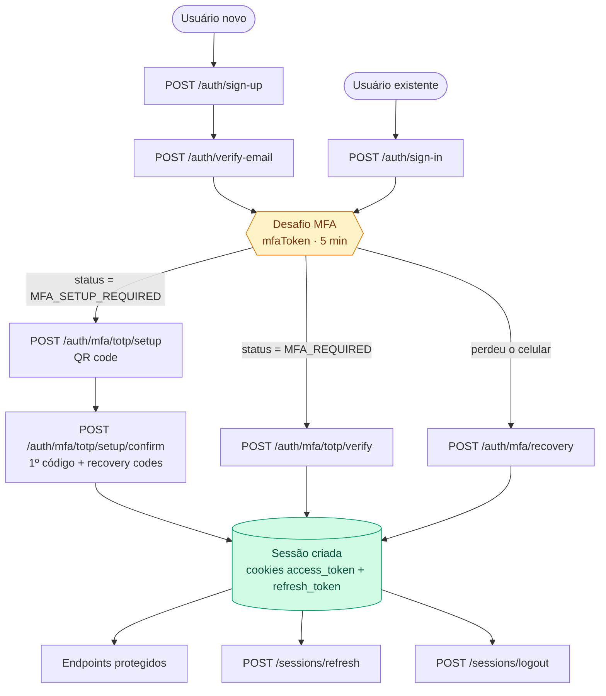
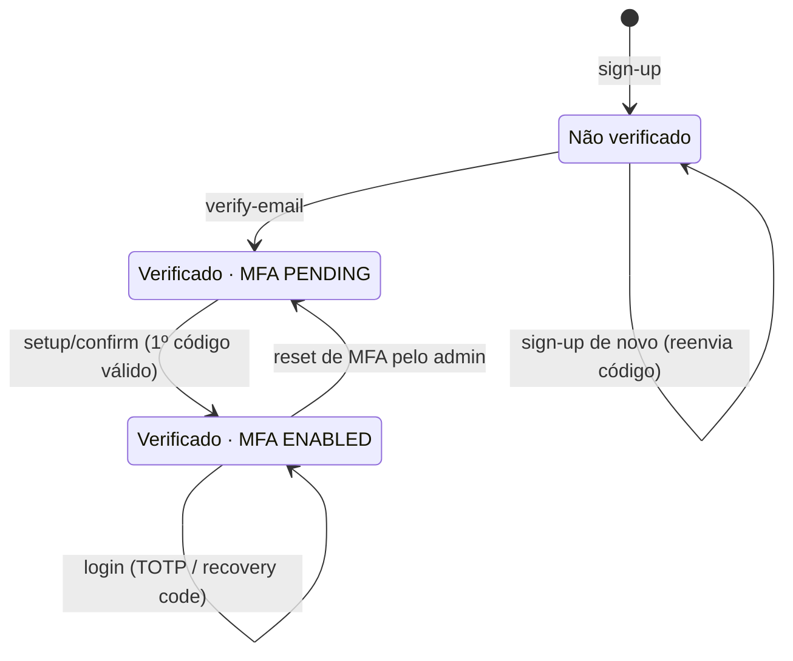
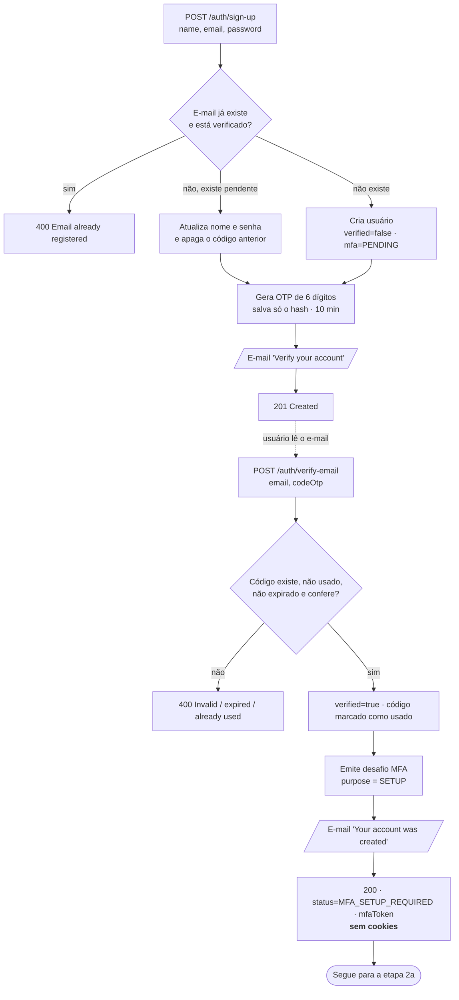
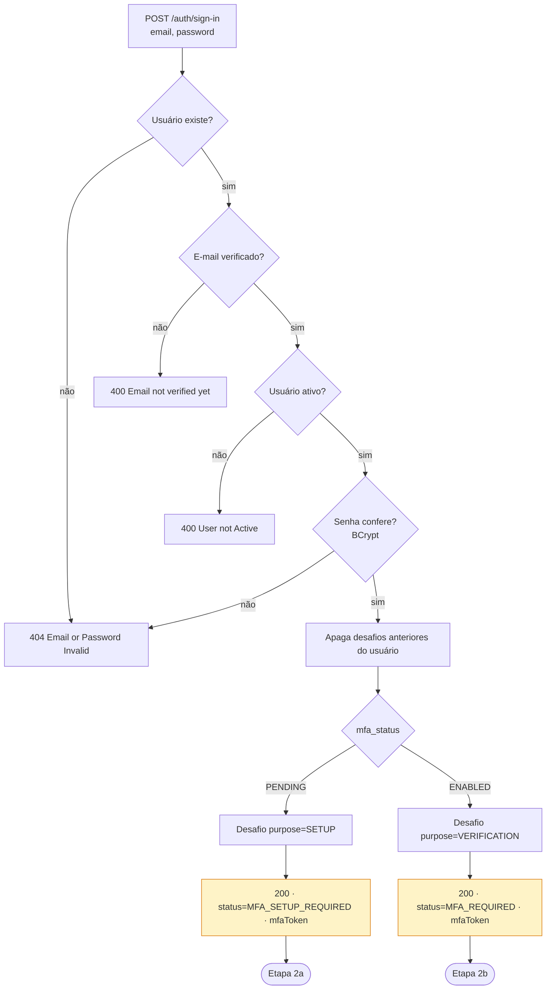
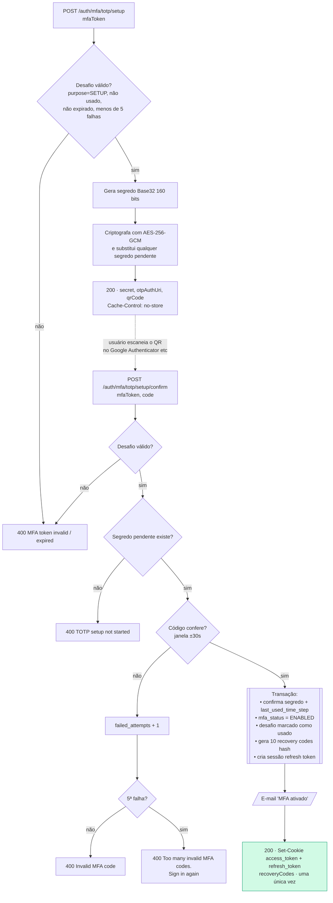
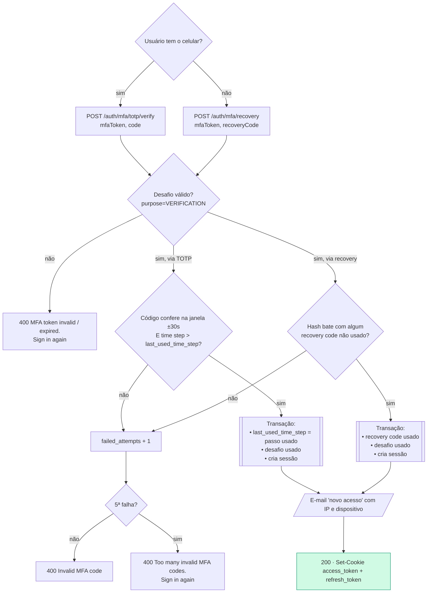
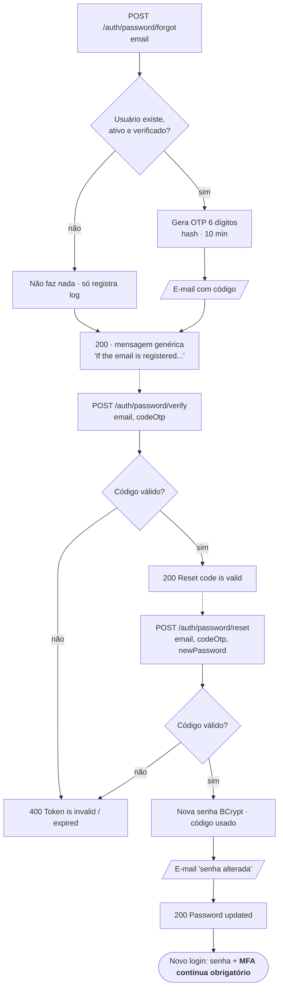
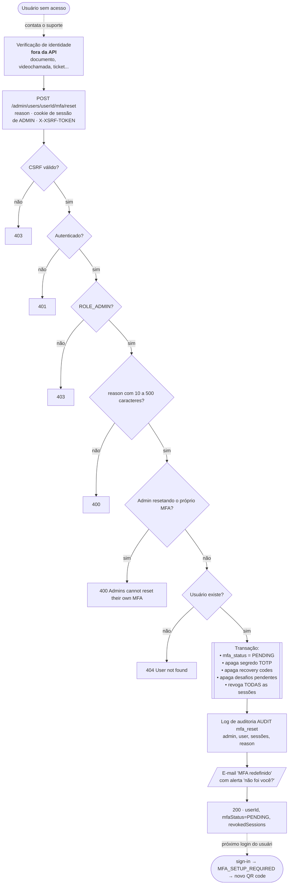
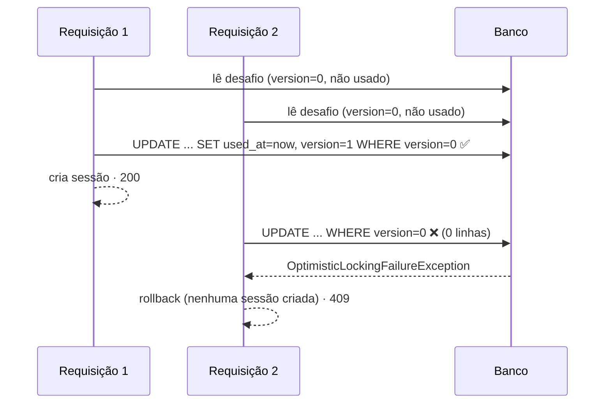
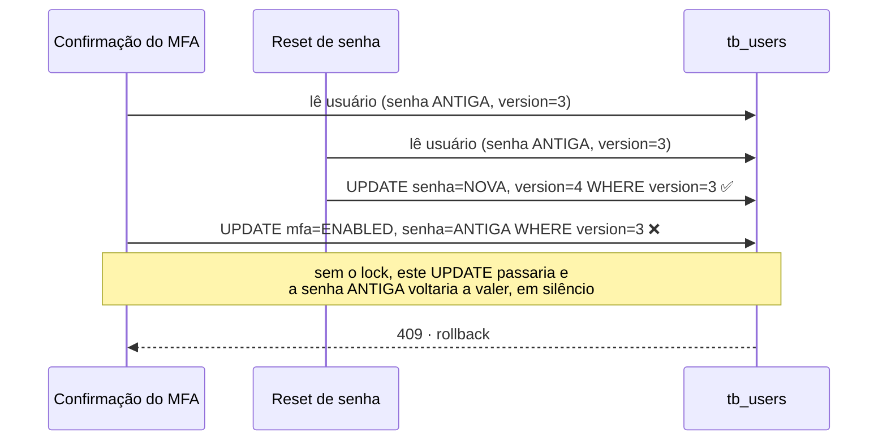

# Fluxo de autenticação

Este documento descreve o fluxo de autenticação de ponta a ponta **depois da introdução do MFA
obrigatório (TOTP)**. Os detalhes do segundo fator, como algoritmo, criptografia e tabelas,
estão em [mfa-totp.md](mfa-totp.md).

## Sumário

1. [Visão geral](#1-visão-geral)
2. [Ciclo de vida do usuário](#2-ciclo-de-vida-do-usuário)
3. [Cadastro e verificação de e-mail](#3-cadastro-e-verificação-de-e-mail)
4. [Login: etapa 1 (senha)](#4-login--etapa-1-senha)
5. [Login: etapa 2a (configuração do autenticador)](#5-login--etapa-2a-configuração-do-autenticador)
6. [Login: etapa 2b (código TOTP ou código de recuperação)](#6-login--etapa-2b-código-totp-ou-código-de-recuperação)
7. [Sessão: requisições autenticadas, refresh, logout e revogação](#7-sessão-requisições-autenticadas-refresh-logout-e-revogação)
8. [Esqueci minha senha](#8-esqueci-minha-senha)
9. [Admin: reset de MFA](#9-admin-reset-de-mfa)
10. [Tokens e credenciais](#10-tokens-e-credenciais)
11. [CSRF](#11-csrf)
12. [Concorrência (lock otimista)](#12-concorrência-lock-otimista)
13. [O que mudou em relação ao fluxo antigo](#13-o-que-mudou-em-relação-ao-fluxo-antigo)

Todas as rotas usam o prefixo `/api/v1`.

---

## 1. Visão geral



**Regra central:** nenhum caminho cria sessão sem passar por um segundo fator. A senha
(no `sign-in`) e o código de e-mail (no `verify-email`) só produzem um **desafio MFA**. Os
cookies de sessão só são gravados nos endpoints `/auth/mfa/**` que validam o TOTP ou um
código de recuperação.

---

## 2. Ciclo de vida do usuário



| Campo         | Valores                 | Efeito no login                                                  |
|---------------|-------------------------|------------------------------------------------------------------|
| `is_verified` | `false` / `true`        | `false` → `400 Email not verified yet`                           |
| `is_active`   | `false` / `true`        | `false` → `400 User not Active`                                  |
| `mfa_status`  | `PENDING` / `ENABLED`   | `PENDING` → `MFA_SETUP_REQUIRED`; `ENABLED` → `MFA_REQUIRED`     |

Usuários que já existiam antes do MFA ficaram com `mfa_status = PENDING` e configuram o
autenticador no próximo login.

---

## 3. Cadastro e verificação de e-mail



**Descrição**

1. O **sign-up** cria o usuário (ou atualiza um cadastro ainda não verificado) e manda um
   código de 6 dígitos por e-mail. Só o hash SHA-256 do código é salvo, com validade de
   10 minutos.
2. O **verify-email** confere o código e marca o e-mail como verificado. **Não cria sessão**:
   devolve um `mfaToken` com `status = MFA_SETUP_REQUIRED`, e o front segue direto para a
   configuração do autenticador. Assim o usuário não precisa digitar a senha de novo logo
   depois do cadastro.

---

## 4. Login: etapa 1 (senha)



**Descrição**

- A resposta **nunca** grava cookies. O corpo traz:

  ```json
  { "status": "MFA_REQUIRED", "mfaToken": "q8m1Yt3...", "expiresAt": "2026-11-08T21:05:00" }
  ```

- O `mfaToken` é um valor aleatório de 256 bits. No banco fica só o hash
  (`tb_mfa_challenges`), junto com o `purpose`, o contador de falhas, a expiração (5 min) e
  o `used_at`.
- **Só existe um desafio ativo por usuário.** Um novo `sign-in` apaga o anterior, então um
  `mfaToken` antigo para de funcionar.
- O e-mail de "novo acesso" **não** é enviado aqui. Ele só sai quando o login é concluído
  na etapa 2.

---

## 5. Login: etapa 2a (configuração do autenticador)

Vale para quem está com `status = MFA_SETUP_REQUIRED`: conta nova, conta antiga
ou conta que passou pelo reset do admin.



**Descrição**

1. **`/totp/setup`** gera o segredo e devolve três formas de vincular o app: o QR code
   (`data:image/png;base64,...`), a URI `otpauth://` e o segredo em texto para digitação
   manual. Pode ser chamado de novo para gerar outro QR. O segredo anterior, ainda não
   confirmado, é descartado.
2. **`/totp/setup/confirm`** exige o primeiro código gerado pelo app. Isso prova que o
   vínculo funcionou antes de ativar o MFA. Se o código estiver certo, tudo acontece
   numa única transação: o MFA é ativado, os 10 códigos de recuperação são criados (só os
   hashes ficam no banco) e a sessão é criada.
3. Os **códigos de recuperação aparecem só nesta resposta**. O front deve obrigar o usuário
   a guardá-los antes de continuar.

---

## 6. Login: etapa 2b (código TOTP ou código de recuperação)

Vale para quem está com `status = MFA_REQUIRED`.



**Descrição**

- **Proteção contra replay:** o `last_used_time_step` impede que um código já aceito, ou um
  código de um passo anterior, seja usado de novo, mesmo dentro dos 30 segundos.
- **Bloqueio:** depois de 5 erros, o desafio fica inutilizado até para o código certo, e o
  usuário precisa digitar a senha de novo. Códigos TOTP errados e códigos de recuperação
  errados contam no mesmo contador.
- **Códigos de recuperação** ignoram maiúsculas e espaços nas pontas e só funcionam uma vez.
- Se o usuário perdeu o celular **e** os códigos de recuperação, só resta o
  [reset pelo admin](#9-admin-reset-de-mfa).

---

## 7. Sessão: requisições autenticadas, refresh, logout e revogação

```mermaid
flowchart TD
    subgraph REQ[Requisição autenticada]
        A[Request com cookie access_token] --> B{JWT válido?<br/>assinatura, issuer, exp}
        B -->|sim| C[SecurityContext = userId + ROLE]
        B -->|não| D[Anônimo]
        C --> E{Método altera estado?<br/>POST/PUT/DELETE}
        D --> E
        E -->|sim| F{Header X-XSRF-TOKEN<br/>= cookie XSRF-TOKEN?}
        F -->|não| G[403]
        F -->|sim| H{Autenticado?}
        E -->|não| H
        H -->|não| I[401 Authentication required]
        H -->|sim| J{@RequiredRole atende?}
        J -->|não| K[403]
        J -->|sim| L[Controller]
    end

    subgraph REF[POST /sessions/refresh]
        M[Cookie refresh_token] --> N{Hash existe?}
        N -->|não| N1[404 Invalid refresh token]
        N -->|sim| O{Revogado?}
        O -->|sim| O1[400 Refresh token revoked<br/>+ limpa cookies]
        O -->|não| P{Expirado? 30 dias}
        P -->|sim| P1[Revoga · 400 expired<br/>+ limpa cookies]
        P -->|não| U{Usuário ativo<br/>e verificado?}
        U -->|não| U1[Revoga esta sessão · 400 User not Active<br/>+ limpa cookies]
        U -->|sim| Q[Novo access_token<br/>mesmo refresh_token]
    end

    subgraph OUT[Logout e revogação]
        R[POST /sessions/logout] --> R1[Revoga o refresh token atual<br/>e limpa os cookies]
        S[DELETE /sessions/revoke/sessionId] --> S1[Revoga uma sessão específica<br/>do próprio usuário]
    end
```

**Descrição**

- O **access token** é um JWT (HMAC256) com `sub = userId` e `role`, entregue no cookie
  `access_token` (`HttpOnly`, `Secure`, `SameSite=Strict`, 15 min).
- O **refresh token** é um valor opaco de 256 bits. No banco fica só o hash, com IP,
  dispositivo e `publicId` (o id público da sessão). Vale 30 dias.
- O `/sessions/refresh` emite um novo access token e **reaproveita o mesmo refresh token**
  (não há rotação).
- **Usuário desativado ou não verificado não renova a sessão.** O refresh confere o usuário
  a cada chamada. Se ele estiver inativo, aquela sessão é revogada e os cookies são limpos.
  As outras sessões dele são recusadas da mesma forma no próximo refresh. Reativar o usuário
  **não** traz de volta as sessões revogadas: ele precisa logar de novo, com senha e MFA.
- Revogar um refresh token, por logout, por revogação, por reset de MFA ou por desativação,
  impede novos refresh. **Um access token já emitido continua válido até expirar (≤ 15 min)**,
  porque ele não é consultado no banco. Esse é um ponto em aberto, detalhado em
  [to-do/access-token-revocation.md](to-do/access-token-revocation.md).

---

## 8. Esqueci minha senha



**Descrição**

- O `forgot` sempre responde a mesma mensagem, para não revelar quais e-mails estão
  cadastrados.
- **O reset de senha não mexe no MFA e não cria sessão.** Depois de trocar a senha, o
  usuário faz o login normal (etapas 1 e 2). Ou seja, quem controla o e-mail da vítima
  consegue trocar a senha, mas não consegue entrar sem o segundo fator.

---

## 9. Admin: reset de MFA

Para quem perdeu o celular **e** os códigos de recuperação.



**Request**

```http
POST /api/v1/admin/users/{userId}/mfa/reset
Cookie: access_token=...; XSRF-TOKEN=...
X-XSRF-TOKEN: <valor do cookie XSRF-TOKEN>
Content-Type: application/json

{ "reason": "Ticket #4821 - identidade confirmada por videochamada" }
```

**Response 200**

```json
{
  "message": "MFA reset. The user must set up a new authenticator on the next sign in",
  "data": { "userId": "1a4a...", "mfaStatus": "PENDING", "revokedSessions": 2 }
}
```

**Descrição e cuidados**

- **A API não verifica a identidade de quem pediu o reset.** Esse é o ponto mais sensível do
  fluxo, porque um atacante com a senha da vítima pode tentar enganar o suporte. Defina um
  procedimento formal, como validação por documento ou videochamada e aprovação de um
  segundo admin, e registre o ticket no `reason`.
- **Um admin não pode resetar o próprio MFA.** Isso impede que uma sessão de admin roubada
  remova o segundo fator da própria conta; outro admin precisa fazer o reset.
- O `reason` vai para o log de auditoria (`AUDIT mfa_reset ...`, nível WARN), com quebras de
  linha removidas para não permitir injeção de linhas falsas no log.
- O usuário recebe um e-mail avisando. Se não foi ele quem pediu, ele fica sabendo na hora.
- Os access tokens do usuário que já foram emitidos continuam válidos até expirar
  (≤ 15 min). Os refresh tokens são revogados na hora. Veja
  [to-do/access-token-revocation.md](to-do/access-token-revocation.md).
- O usuário continua precisando da **senha**. O reset só troca o segundo fator.

---

## 10. Tokens e credenciais

| Credencial             | Formato                 | Onde fica no cliente              | No banco                       | Validade   | Uso único |
|------------------------|-------------------------|-----------------------------------|--------------------------------|------------|:---------:|
| Senha                  | texto                   | —                                 | hash BCrypt                    | —          | —         |
| OTP de e-mail          | 6 dígitos               | e-mail                            | hash SHA-256                   | 10 min     | ✅        |
| OTP de reset de senha  | 6 dígitos               | e-mail                            | hash SHA-256                   | 10 min     | ✅        |
| `mfaToken`             | 256 bits base64url      | **memória** do front              | hash SHA-256                   | 5 min      | ✅        |
| Segredo TOTP           | Base32, 160 bits        | app autenticador                  | **AES-256-GCM**                | —          | —         |
| Código TOTP            | 6 dígitos               | app autenticador                  | — (último passo usado)         | 30 s (±30 s) | ✅      |
| Recovery code          | `xxxx-xxxx-xxxx-xxxx`   | guardado pelo usuário             | hash SHA-256                   | —          | ✅        |
| `access_token`         | JWT HMAC256             | cookie `HttpOnly` `Secure` `Strict` | —                            | 15 min     | —         |
| `refresh_token`        | 256 bits base64url      | cookie `HttpOnly` `Secure` `Strict` | hash SHA-256                 | 30 dias    | —         |
| `XSRF-TOKEN`           | token CSRF              | cookie legível pelo JS            | —                              | sessão     | —         |

---

## 11. CSRF

- A configuração é `csrf.spa()` (Spring Security 7). O servidor grava o cookie `XSRF-TOKEN`
  (legível pelo JS) e o front devolve o **mesmo valor** no header `X-XSRF-TOKEN` em todo
  `POST`/`PUT`/`PATCH`/`DELETE`. O axios e o `HttpClient` do Angular têm suporte nativo a esse padrão.
- Ficam **isentos**: `/auth/sign-in`, `/auth/sign-up`, `/auth/verify-email`,
  `/auth/password/**`, `/auth/mfa/**` (já protegidos pelo `mfaToken` no corpo),
  `/sessions/refresh` e `/sessions/logout`.
- **Exigem CSRF:** os demais, incluindo `DELETE /sessions/revoke/{id}` e
  `POST /admin/users/{id}/mfa/reset`.

> **Correção feita junto com o MFA:** antes, a configuração usava o handler XOR padrão do
> Spring Security 6+, que **recusava** o valor cru do cookie no header. Na prática, todo
> endpoint autenticado com `POST`/`DELETE` respondia 403 para um front SPA. O `spa()`
> corrige isso sem tirar a proteção.

---

## 12. Concorrência (lock otimista)

`tb_users`, `tb_mfa_challenges`, `tb_user_totp_secrets` e `tb_mfa_recovery_codes` têm uma
coluna `version` (`@Version`). Toda atualização vira `UPDATE ... WHERE id = ? AND version = ?`.



Sem o lock, várias requisições simultâneas com o mesmo `mfaToken` e o mesmo código podiam
passar todas e criar várias sessões. Com o lock, **só uma vence** e as outras recebem
`409 The request conflicted with a concurrent request. Please try again`. Isso foi
verificado com 12 requisições simultâneas: 1 × `200` e 11 × `409`, tanto no
`/totp/verify` quanto no `/recovery`.

### Por que também em `tb_users` (atualização perdida)

O `save` do usuário grava a **linha inteira** a partir do que foi lido antes. Sem o lock,
duas operações simultâneas que alteram campos diferentes se sobrescreviam:



Agora a segunda gravação falha com 409 e é desfeita, em vez de reverter a troca de senha sem
ninguém perceber. Teste com 10 gravações simultâneas no mesmo usuário: nenhum 5xx, e a
`version` final aumentou exatamente o número de gravações bem-sucedidas, ou seja, nenhuma
atualização se perdeu.

> **Detalhe de implementação:** com `@Version` no `UserEntity`, as FKs para o usuário passaram
> a usar `userRepository.getReferenceById(id)` (um proxy gerenciado, sem SELECT) em vez de
> `UserEntity.builder().id(id).build()`. Com `version = null`, o Hibernate trataria esse
> objeto montado à mão como uma entidade nova e recusaria a gravação.

---

## 13. O que mudou em relação ao fluxo antigo

| Antes                                                        | Agora                                                                     |
|--------------------------------------------------------------|---------------------------------------------------------------------------|
| `sign-in` com senha certa → cookies de sessão                | `sign-in` → `mfaToken`; cookies só depois do TOTP                         |
| `verify-email` → cookies de sessão                           | `verify-email` → `mfaToken` de setup                                      |
| E-mail de "novo acesso" enviado depois da senha              | Enviado só depois do segundo fator                                        |
| Sem recuperação de conta além do reset de senha              | Recovery codes + reset de MFA pelo admin                                  |
| Header `X-XSRF-TOKEN` com o valor do cookie → 403            | Aceito (`csrf.spa()`)                                                     |
| Requisições concorrentes podiam reutilizar desafio ou código | Lock otimista: só uma vence, as outras recebem 409                        |
| Gravações simultâneas no usuário podiam se sobrescrever      | Lock otimista em `tb_users`                                               |
| Usuário desativado continuava renovando a sessão por 30 dias | Refresh recusa usuário inativo e revoga a sessão                          |

**Impacto no front:** as telas de login e de verificação de e-mail precisam tratar o `status`
devolvido e seguir para as telas de setup ou de código. O guia está em
[mfa-totp.md › Guia de integração do frontend](mfa-totp.md#guia-de-integração-do-frontend).
