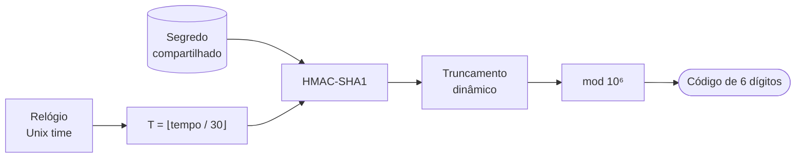
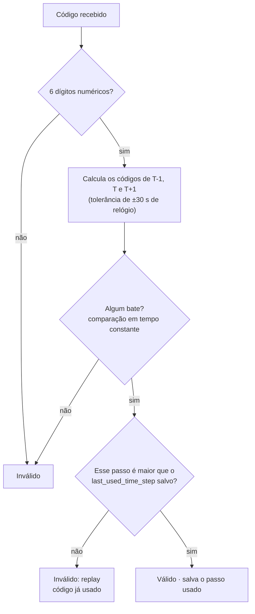
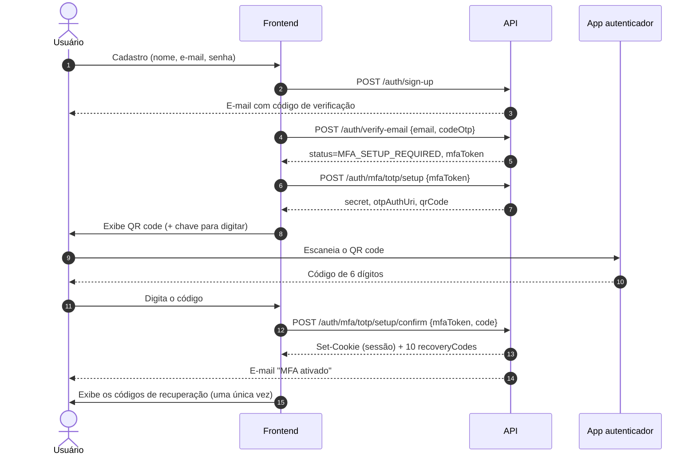
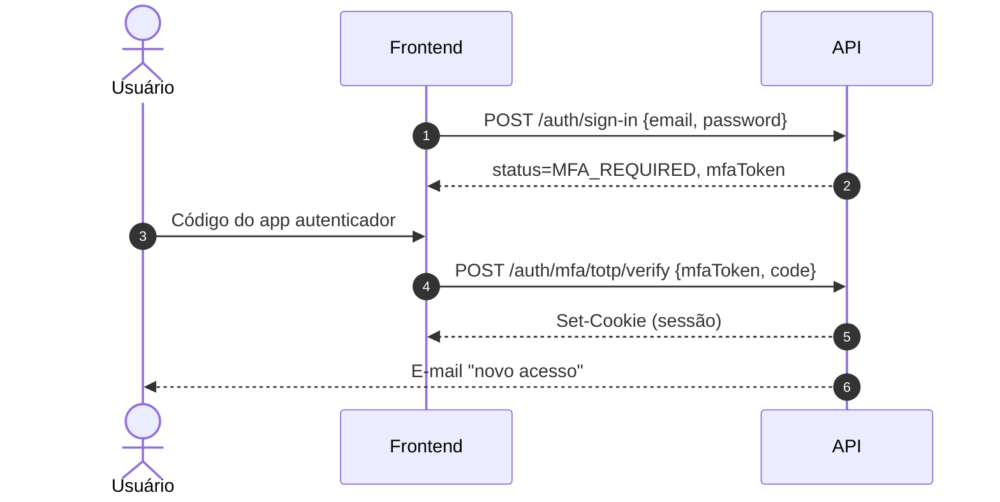

# MFA obrigatório com TOTP

> Branch: `feat/totp-multi-factor-authentication`

Todo login exige um segundo fator: um código de 6 dígitos gerado por um **app autenticador**
(Google Authenticator, Microsoft Authenticator, Authy, 1Password, Bitwarden etc.).
O padrão usado é o **TOTP (RFC 6238)**, implementado com a biblioteca
[`dev.samstevens.totp`](https://github.com/samdjstevens/java-totp) `1.7.1`.

## Sumário

- [Como o TOTP funciona](#como-o-totp-funciona)
- [Visão geral](#visão-geral)
- [Fluxos](#fluxos)
- [Endpoints](#endpoints)
- [Reset de MFA pelo admin](#reset-de-mfa-pelo-admin)
- [Guia de integração do frontend](#guia-de-integração-do-frontend)
- [Configuração](#configuração)
- [Modelo de dados](#modelo-de-dados)
- [Usuários já existentes (migração)](#usuários-já-existentes-migração)
- [Decisões de segurança](#decisões-de-segurança)
- [Arquitetura (onde está cada coisa)](#arquitetura-onde-está-cada-coisa)
- [Testes](#testes)
- [Limitações e próximos passos](#limitações-e-próximos-passos)
- [Passo a passo: usando a API pelos endpoints](#passo-a-passo-usando-a-api-pelos-endpoints)

## Como o TOTP funciona

TOTP (*Time-based One-Time Password*, [RFC 6238](https://datatracker.ietf.org/doc/html/rfc6238))
é um código de 6 dígitos que **o celular e o servidor calculam cada um por conta própria**, sem
trocar mensagens, a partir de duas coisas que os dois têm: um **segredo compartilhado** e o
**relógio**. Como só quem tem o segredo consegue gerar o código certo, informar o código prova
que você está com o celular onde o segredo foi cadastrado.



### Passo 1: o segredo é combinado uma única vez (setup)

1. O servidor gera **20 bytes aleatórios (160 bits)**, com `SecureRandom`, e os codifica em
   **Base32**, o que dá 32 caracteres como `JBSWY3DPEHPK3PXP...`.
2. O segredo vai para o app dentro de uma URI `otpauth://`, normalmente em forma de QR code:

   ```
   otpauth://totp/Financial%20API:joao%40email.com?secret=JBSW...&issuer=Financial%20API&algorithm=SHA1&digits=6&period=30
   ```

3. A partir daí **os dois lados guardam o mesmo segredo**: o app no celular e o servidor no
   banco (criptografado com AES-256-GCM). O segredo nunca mais trafega.

### Passo 2: o tempo vira um contador

Os dois lados dividem o horário atual (segundos desde 1970, *Unix time*) por 30 e descartam a
parte decimal:

```
T = floor(unix_time / 30)
```

`T` é o *time step*. Ele muda a cada 30 segundos, e é por isso que o código do app muda a cada
30 segundos. Celular e servidor chegam ao mesmo `T` sem conversar, desde que os relógios
estejam razoavelmente certos.

### Passo 3: HMAC do contador com o segredo

O `T` vira 8 bytes (*big-endian*) e passa por um **HMAC-SHA1** usando o segredo como chave. O
resultado são 20 bytes que parecem aleatórios, mas são determinísticos: mesmo segredo e
mesmo `T` dão sempre o mesmo resultado.

### Passo 4: truncamento dinâmico

Dos 20 bytes, escolhem-se 4:

1. `offset` = os 4 bits mais baixos do **último** byte (um número de 0 a 15);
2. pegam-se os 4 bytes a partir de `offset`;
3. zera-se o bit mais alto, o que dá um inteiro positivo de 31 bits.

### Passo 5: o código de 6 dígitos

```
código = inteiro_31_bits mod 1.000.000   (com zeros à esquerda, ex.: 042917)
```

### Exemplo real (vetor de teste da RFC 6238)

| Etapa                 | Valor                                                    |
|-----------------------|----------------------------------------------------------|
| Segredo (ASCII)       | `12345678901234567890`                                   |
| Segredo (Base32)      | `GEZDGNBVGY3TQOJQGEZDGNBVGY3TQOJQ`                       |
| Unix time             | `59`                                                     |
| `T = ⌊59 / 30⌋`       | `1`                                                      |
| HMAC-SHA1             | `75a48a19d4cbe100644e8ac1397eea747a2d33ab`               |
| `offset` (último byte `ab` → `b`) | `11`                                         |
| 4 bytes a partir do 11 | `c1397eea` → sem o bit alto → `1094287082`              |
| `mod 10⁶`             | **`287082`**                                             |

A RFC usa 8 dígitos nesse exemplo e chega a `94287082`. Os últimos 6 dígitos (`287082`) são
exatamente o que a nossa API e o Google Authenticator calculariam.

### Passo 6: como o servidor valida



- **Janela ±1:** se o celular estiver até 30 s adiantado ou atrasado, o código ainda vale.
- **Anti-replay:** depois que um código é aceito, ele e qualquer código **anterior** passam a
  ser recusados, mesmo dentro dos 30 s em que ainda seriam "válidos".
- **Força bruta:** um código de 6 dígitos tem só 1 milhão de combinações, por isso cada
  desafio aceita no máximo 5 erros (veja [Decisões de segurança](#decisões-de-segurança)).

> **Por que isso funciona offline?** O app não fala com o servidor: ele só precisa do segredo,
> guardado no setup, e do relógio do celular. Por isso o Google Authenticator funciona em modo
> avião.

---

## Visão geral

O MFA é **obrigatório**. Por isso:

1. **A senha correta não cria sessão.** O `/auth/sign-in` devolve só um `mfaToken`
   (desafio de uso único, válido por 5 minutos) e um `status` que diz qual é o próximo passo.
2. **O `/auth/verify-email` também não cria sessão.** Antes ele já logava o usuário, o que
   seria um bypass do MFA. Agora ele devolve um desafio de configuração do TOTP.
3. A sessão (cookies `access_token` e `refresh_token`) só é criada depois que um código
   TOTP válido (ou um código de recuperação) é informado.

Cada usuário tem um campo `mfaStatus`:

| `mfaStatus` | Significado                                     | O `sign-in` devolve      |
|-------------|-------------------------------------------------|--------------------------|
| `PENDING`   | Ainda não vinculou um autenticador (padrão)     | `MFA_SETUP_REQUIRED`     |
| `ENABLED`   | TOTP ativo                                      | `MFA_REQUIRED`           |

---

## Fluxos

### Primeiro acesso (cadastro → configuração do autenticador)



Usuários `PENDING` que fazem login (por exemplo, contas antigas) seguem o mesmo caminho
a partir do passo 5: o `/auth/sign-in` devolve `MFA_SETUP_REQUIRED`.

### Login do dia a dia



Se o usuário perdeu o celular, no passo 4 o frontend chama
`POST /auth/mfa/recovery {mfaToken, recoveryCode}`.

---

## Endpoints

Todas as rotas têm o prefixo `/api/v1`. Os endpoints de MFA são públicos para o Spring
Security: quem autentica a chamada é o `mfaToken`.

### `POST /auth/sign-in`

```json
{ "email": "joao@email.com", "password": "minhaSenha123" }
```

**200**:

```json
{
  "message": "MFA required to complete sign in",
  "data": {
    "status": "MFA_REQUIRED",
    "mfaToken": "q8m1Yt3...b2Q",
    "expiresAt": "2026-11-08T21:05:00"
  }
}
```

`status` é `MFA_SETUP_REQUIRED` ou `MFA_REQUIRED`. Uma senha errada continua devolvendo
**404** `Email or Password Invalid`. **Não há cookies** nesta resposta.

### `POST /auth/verify-email`

Mesmo request de antes (`email`, `codeOtp`). A resposta agora tem o mesmo formato da do
`sign-in`, com `status: "MFA_SETUP_REQUIRED"` e sem cookies.

### `POST /auth/mfa/totp/setup`

Exige um `mfaToken` com status `MFA_SETUP_REQUIRED`.

```json
{ "mfaToken": "..." }
```

**200** (com `Cache-Control: no-store`):

```json
{
  "message": "Scan the QR code with your authenticator app",
  "data": {
    "secret": "JBSWY3DPEHPK3PXPJBSWY3DPEHPK3PXP",
    "otpAuthUri": "otpauth://totp/Financial%20API%3Ajoao%40email.com?secret=JBSW...&issuer=Financial%20API&algorithm=SHA1&digits=6&period=30",
    "qrCode": "data:image/png;base64,iVBORw0KGgo..."
  }
}
```

- `qrCode` pode ser usado direto em ``.
- `secret` serve para quem prefere digitar a chave no app em vez de escanear.
- Chamar de novo **substitui** o segredo pendente. Use isso para "gerar outro QR code".

### `POST /auth/mfa/totp/setup/confirm`

```json
{ "mfaToken": "...", "code": "123456" }
```

**200**: grava os cookies de sessão e devolve os códigos de recuperação:

```json
{
  "message": "MFA enabled. Store your recovery codes in a safe place",
  "data": {
    "recoveryCodes": ["q3k9-a8f2-m1x7-p0d4", "..."]
  }
}
```

### `POST /auth/mfa/totp/verify`

Exige um `mfaToken` com status `MFA_REQUIRED`.

```json
{ "mfaToken": "...", "code": "123456" }
```

**200**: grava os cookies de sessão, devolve `{"message": "Login successful", "data": null}`
e envia o e-mail de novo acesso.

### `POST /auth/mfa/recovery`

```json
{ "mfaToken": "...", "recoveryCode": "q3k9-a8f2-m1x7-p0d4" }
```

**200**: igual ao `/totp/verify`. O código fica inutilizado. Maiúsculas e espaços nas
pontas são ignorados.

### Erros (todos **400**, no formato padrão `ErrorResponse`)

| `message`                                                   | Quando                                                        | O que o front faz                 |
|-------------------------------------------------------------|---------------------------------------------------------------|-----------------------------------|
| `Invalid MFA code`                                          | Código errado ou reutilizado                                  | Pede o código de novo             |
| `Too many invalid MFA codes. Sign in again`                 | 5º código errado no mesmo desafio                             | Volta para a tela de login        |
| `MFA token is expired, was already used or has too many failed attempts. Sign in again` | Desafio expirado, já usado ou bloqueado | Volta para a tela de login        |
| `MFA token is invalid`                                      | Token inexistente ou usado no endpoint errado                 | Volta para a tela de login        |
| `TOTP setup not started. Call the setup endpoint first`     | `/setup/confirm` chamado antes do `/setup`                    | Chama o `/setup`                  |
| `MFA is already enabled`                                    | `/setup` chamado por quem já tem MFA                          | Vai para o `/totp/verify`         |
| `code: MFA code must contain 6 digits`                      | Falha de validação do código                                  | Valida o campo no front           |

Além disso, **409** `The request conflicted with a concurrent request. Please try again`
aparece quando duas requisições usam o mesmo desafio ou código ao mesmo tempo (lock otimista;
veja abaixo). O front pode tratar como "tente novamente" ou recarregar o estado.

---

## Reset de MFA pelo admin

Para quem perdeu o celular **e** os códigos de recuperação.

```http
POST /api/v1/admin/users/{userId}/mfa/reset
Cookie: access_token=<sessão de ADMIN>; XSRF-TOKEN=...
X-XSRF-TOKEN: <valor do cookie XSRF-TOKEN>

{ "reason": "Ticket #4821 - identidade confirmada por videochamada" }
```

**200**:

```json
{
  "message": "MFA reset. The user must set up a new authenticator on the next sign in",
  "data": { "userId": "1a4a...", "mfaStatus": "PENDING", "revokedSessions": 2 }
}
```

Em uma única transação, o reset:

1. volta o `mfa_status` para `PENDING`;
2. apaga o segredo TOTP, os códigos de recuperação e os desafios pendentes;
3. revoga **todas** as sessões (refresh tokens) do usuário.

Depois disso, grava o log de auditoria `AUDIT mfa_reset admin=… user=… revokedSessions=… reason="…"`
e envia ao usuário o e-mail "MFA redefinido", com o alerta "não foi você?".

| Resposta | Quando                                                          |
|----------|-----------------------------------------------------------------|
| 403      | Sem header CSRF válido, ou usuário sem `ROLE_ADMIN`             |
| 401      | Sem sessão (com CSRF válido)                                    |
| 400      | `reason` fora de 10 a 500 caracteres, ou admin resetando o próprio MFA |
| 404      | Usuário não encontrado                                          |

> ⚠️ **A API não confirma a identidade do solicitante.** Essa verificação (documento,
> videochamada, segundo aprovador) é um procedimento do suporte e deve vir **antes** do
> reset. Registre o ticket no `reason`. O usuário continua precisando da senha; o reset só
> troca o segundo fator. Os access tokens já emitidos valem até expirar (≤ 15 min); veja
> [to-do/access-token-revocation.md](to-do/access-token-revocation.md).

---

## Guia de integração do frontend

```text
login(email, senha)
  └─ POST /auth/sign-in ─► data.status
        ├─ "MFA_REQUIRED"        ─► tela "Digite o código do autenticador"
        │                            └─ POST /auth/mfa/totp/verify
        │                            └─ link "Perdi meu celular" ─► POST /auth/mfa/recovery
        └─ "MFA_SETUP_REQUIRED"  ─► POST /auth/mfa/totp/setup
                                     └─ tela com QR code + chave manual
                                     └─ POST /auth/mfa/totp/setup/confirm
                                     └─ tela "Guarde seus códigos de recuperação"
                                        (download/copiar, checkbox "Já guardei")
```

Recomendações:

- Guarde o `mfaToken` **só em memória** (estado do componente), nunca em `localStorage`.
- Use um campo `inputmode="numeric" autocomplete="one-time-code" maxlength="6"`.
- Mostre o `expiresAt`. O desafio dura 5 minutos; depois o usuário precisa digitar a senha de novo.
- Os códigos de recuperação **só aparecem uma vez**. Não deixe o usuário seguir sem confirmar que guardou.

---

## Configuração

Variáveis novas no `framework/env.properties`:

| Variável             | Obrigatória | Exemplo / padrão           | Descrição                                                                 |
|----------------------|:-----------:|----------------------------|---------------------------------------------------------------------------|
| `MFA_ENCRYPTION_KEY` | ✅          | `openssl rand -base64 32`  | Chave AES (Base64, 16/24/32 bytes; use 32) que criptografa os segredos TOTP |
| `MFA_ISSUER`         | ❌          | `Financial API`            | Nome exibido no app autenticador                                          |

```bash
echo "MFA_ENCRYPTION_KEY=$(openssl rand -base64 32)" >> framework/env.properties
```

> ⚠️ **Não perca nem troque a `MFA_ENCRYPTION_KEY`.** Sem ela não dá para descriptografar os
> segredos, e **todos os usuários perdem o acesso via TOTP** (sobram só os códigos de
> recuperação). Guarde-a num cofre de segredos e use uma chave diferente por ambiente.

A aplicação **não sobe** se a chave estiver ausente ou inválida. A falha acontece na
inicialização, e não no primeiro login.

No `application.yaml`:

```yaml
app:
  security:
    mfa:
      issuer: ${MFA_ISSUER:Financial API}
      encryption-key: ${MFA_ENCRYPTION_KEY}
```

---

## Modelo de dados

O `ddl-auto: update` cria tudo automaticamente.

**`tb_users`**: coluna nova:

| Coluna       | Tipo          | Observação                                  |
|--------------|---------------|---------------------------------------------|
| `mfa_status` | `varchar(20)` | `NOT NULL DEFAULT 'PENDING'` (`PENDING`/`ENABLED`) |

**`tb_user_totp_secrets`**: um registro por usuário:

| Coluna                | Observação                                                         |
|-----------------------|--------------------------------------------------------------------|
| `user_id` (unique)    | FK para `tb_users`                                                 |
| `encrypted_secret`    | `Base64(IV ‖ AES-GCM(secret))`                                     |
| `last_used_time_step` | Último *time step* aceito (anti-replay)                            |
| `confirmed_at`        | `null` enquanto o setup não foi confirmado                         |

**`tb_mfa_challenges`**: desafios de login:

| Coluna            | Observação                                         |
|-------------------|----------------------------------------------------|
| `token_hash`      | SHA-256 do `mfaToken` (o token puro nunca é salvo) |
| `purpose`         | `SETUP` ou `VERIFICATION`                          |
| `failed_attempts` | Bloqueia em 5                                      |
| `expires_at` / `used_at` | Expira em 5 min e só pode ser usado uma vez |

**`tb_mfa_recovery_codes`**: 10 por usuário, `code_hash` (SHA-256) e `used_at`.

---

## Usuários já existentes (migração)

Quando a aplicação sobe, o Hibernate executa:

```sql
alter table if exists tb_users
  add column mfa_status varchar(20) default 'PENDING' not null ...
```

Todos os usuários existentes ficam `PENDING` e configuram o autenticador **no próximo
login**. Não precisa de script manual. Isso foi validado simulando uma tabela antiga com
usuários.

---

## Decisões de segurança

| Ameaça                                       | Mitigação                                                                                      |
|----------------------------------------------|------------------------------------------------------------------------------------------------|
| Senha vazada                                  | A senha sozinha não cria sessão; é preciso o código TOTP                                       |
| Bypass pelo `verify-email`                    | O `verify-email` não emite tokens; só libera o setup                                          |
| Vazamento do banco                            | O segredo TOTP fica criptografado (AES-256-GCM); `mfaToken` e códigos de recuperação ficam só como hash |
| Força bruta do código (10⁶ combinações)       | Máximo de 5 erros por desafio; depois é preciso digitar a senha de novo                        |
| Reutilização de código interceptado (replay)  | `last_used_time_step`: um código, ou um código anterior a ele, nunca é aceito duas vezes       |
| Relógio do celular dessincronizado            | Janela de ±1 *time step* (±30 s)                                                                |
| Ataques de tempo na comparação                | Comparações em tempo constante (`MessageDigest.isEqual`)                                       |
| Desafio roubado / reaproveitado               | `mfaToken` de 256 bits, uso único, expira em 5 min; um novo login invalida o anterior          |
| Token de setup usado para logar (e vice-versa)| `purpose` validado em cada endpoint                                                            |
| Cache de QR code ou códigos de recuperação    | `Cache-Control: no-store` no `/setup` e no `/setup/confirm`                                    |
| Ativação de MFA sem o usuário saber           | E-mail "MFA ativado" com alerta de "Não foi você?"                                             |
| Requisições concorrentes com o mesmo desafio/código | **Lock otimista** (`@Version`) em usuário, desafio, segredo e recovery codes: só uma vence, as outras recebem 409 |
| Perda do autenticador e dos recovery codes    | Reset pelo admin, com auditoria, e-mail ao usuário e revogação de todas as sessões; admin não reseta o próprio MFA |

**Compatibilidade com apps:** os parâmetros são fixos em **SHA1 / 6 dígitos / 30 s**.
Versões antigas do Google Authenticator ignoram outros valores, e qualquer mudança aqui
faria os códigos pararem de bater.

---

## Arquitetura (onde está cada coisa)

Segue a arquitetura hexagonal do projeto: as regras ficam no `core` e a lib TOTP, o JPA e a
criptografia ficam no `framework`, atrás de portas.

```
core/src/main/java/com/auth/api/core/
├── shared/enumerated/MfaStatus.java                  # PENDING | ENABLED
├── user/domain/UserDomain.java                       # + mfaStatus, enableMfa(), isMfaEnabled()
└── auth/
    ├── domain/
    │   ├── MfaChallengeDomain.java                   # desafio (TTL, tentativas, uso único)
    │   ├── MfaChallengePurpose.java                  # SETUP | VERIFICATION
    │   ├── UserTotpDomain.java                       # segredo + anti-replay
    │   └── RecoveryCodeDomain.java
    └── application/
        ├── port/in/mfa/                              # SetupTotp, ConfirmTotpSetup, VerifyTotp,
        │                                             # VerifyRecoveryCode, IssueMfaChallenge...
        ├── port/out/                                 # TotpPort, SecretEncryptionPort,
        │                                             # *PersistencePort
        └── service/                                  # mesma divisão de port/in
            ├── sign/
            │   ├── SignInService.java                # senha ⇒ desafio MFA (sem tokens)
            │   ├── SignUpService.java / SignOutService.java
            │   ├── IssueAuthTokensService.java
            │   └── SignInNotifier.java               # e-mail de novo acesso (pós-MFA)
            ├── mfa/
            │   ├── IssueMfaChallengeService.java
            │   ├── MfaChallengeValidator.java        # valida token/purpose, conta falhas
            │   ├── SetupTotpService.java
            │   ├── ConfirmTotpSetupService.java
            │   ├── VerifyTotpService.java
            │   ├── VerifyRecoveryCodeService.java
            │   └── AdminResetMfaService.java         # reset pelo admin + auditoria
            ├── emailVerification/
            │   └── VerifyEmailVerificationTokenService.java  # e-mail ⇒ desafio de SETUP
            ├── refreshToken/                         # Renew / Revoke
            └── password/reset/                       # Send / Verify / Update + ResetPasswordTokenValidator

framework/src/main/java/com/auth/api/framework/auth/
├── adapter/port/in/web/
│   ├── AuthController.java                       # sign-in/verify-email devolvem o desafio
│   ├── MfaController.java                        # /auth/mfa/**
│   ├── AdminMfaController.java                   # /admin/users/{id}/mfa/reset (ADMIN)
│   └── support/                                  # AuthCookieWriter, ClientRequestInfo
├── adapter/port/out/persistence/                 # MfaChallenge/UserTotp/RecoveryCode adapters + entities
├── utils/mfa/
│   ├── TotpAdapter.java                          # lib dev.samstevens.totp
│   ├── AesGcmSecretEncryptionAdapter.java
│   └── MfaProperties.java
├── utils/token/                                  # MfaChallengeTokenGenerator, MfaHasher
└── config/bean/MfaBeanConfig.java

framework/src/main/resources/templates/mfa-enabled-email.html, mfa-reset-email.html
```

**Por que não usar o `DefaultCodeVerifier` da lib?** Ele só devolve `true`/`false`. Para
bloquear replay é preciso saber **qual** *time step* casou, então o `TotpAdapter` percorre a
janela usando o `DefaultCodeGenerator` e o `TimeProvider` da própria lib. O resto (geração do
segredo, URI, QR code e códigos de recuperação) também vem da lib.

---

## Testes

**Unitários** (`framework/src/test/.../auth/utils/mfa/`), com `mvn test`:

- `TotpAdapterTest` (9 testes): código atual aceito, tolerância de ±1 passo, recusa fora da
  janela, anti-replay, códigos malformados, formato da URI compatível com o Google
  Authenticator, segredo Base32 de 160 bits, QR code PNG e códigos de recuperação únicos.
- `AesGcmSecretEncryptionAdapterTest` (5 testes): ida e volta, IV aleatório, detecção de
  adulteração, chave errada e validação da chave.

**Ponta a ponta:** o fluxo completo foi exercitado contra a aplicação rodando (banco
isolado e SMTP falso), com **25/25 verificações**: cadastro, setup, confirmação, login,
replay, tolerância de relógio, códigos de recuperação, bloqueio após 5 erros, troca de
`purpose`, ausência de cookies antes do MFA e envio dos e-mails.

Também foram verificados:

- **Lock otimista (6/6):** 12 requisições simultâneas com o mesmo `mfaToken` e código
  resultaram em exatamente 1 × `200` e 11 × `409`, com uma única sessão gravada. O mesmo
  vale para o `/recovery`, e o código de recuperação foi marcado como usado uma única vez.
- **Reset de admin (16/16):** 401 sem sessão, 403 para não-admin e sem CSRF, 400 para
  `reason` curto e para auto-reset, 404 para usuário inexistente. No reset bem-sucedido o
  status volta para `PENDING`, o segredo, os códigos e os desafios são apagados, todas as
  sessões são revogadas (o refresh antigo para de funcionar) e o e-mail é enviado. Depois
  disso, o próximo login pede `MFA_SETUP_REQUIRED`, o usuário consegue configurar um novo
  autenticador e os códigos e o autenticador antigos deixam de funcionar.

> O `FrameworkApplicationTests` sobe o contexto inteiro e conecta no banco do
> `env.properties`. Ele precisa da `MFA_ENCRYPTION_KEY` configurada.

---

## Limitações e próximos passos

- **Regenerar códigos de recuperação:** um endpoint autenticado (JWT + código TOTP) para
  gerar um novo lote. Também vale avisar quando restarem poucos códigos.
- **Rate limit:** o limite de 5 erros é **por desafio**. Um atacante com a senha pode fazer
  novos logins para ganhar novas tentativas. Aplique o rate limiter (Redis) por usuário e
  por IP em `/auth/sign-in` e `/auth/mfa/**`.
- **Access token após reset ou logout:** o JWT continua válido até expirar (≤ 15 min).
  Análise e opções em [to-do/access-token-revocation.md](to-do/access-token-revocation.md).
- **Rotação da `MFA_ENCRYPTION_KEY`:** não há suporte a várias chaves. Para rotacionar, seria
  preciso um prefixo de versão no `encrypted_secret` e um job de recriptografia.
- **Duplicação de cookies:** o `SessionController` ainda tem a própria lógica de cookies;
  ele pode passar a usar o `AuthCookieWriter`.


---

## Passo a passo: usando a API pelos endpoints

Roteiro para testar o fluxo inteiro pelo **Scalar** (`http://localhost:<APP_PORT>/api/v1/scalar`)
ou por qualquer cliente HTTP.

### Antes de começar

- Suba o banco (`docker compose up -d`) e confira se `MFA_ENCRYPTION_KEY` está no
  `framework/env.properties`. Sem ela a aplicação não inicia.
- Cadastre um **e-mail real**: o código de verificação é enviado pelo SMTP configurado.
- Use **Chrome ou Firefox**. Os cookies de sessão são `Secure`, e esses navegadores os aceitam
  em `http://localhost`; o Safari pode descartá-los.
- Tenha um app autenticador no celular (Google Authenticator, Microsoft Authenticator, Authy...).

### Primeiro acesso

**1. Cadastro: `POST /auth/sign-up`**

```json
{ "name": "João Silva", "email": "joao@email.com", "password": "MinhaSenha123!" }
```

Você recebe por e-mail um **código de verificação** de 6 dígitos, válido por 10 minutos.

**2. Verificar o e-mail: `POST /auth/verify-email`**

```json
{ "email": "joao@email.com", "codeOtp": "123456" }
```

Copie o `mfaToken` da resposta. O `status` vem como `MFA_SETUP_REQUIRED`.

```json
{ "data": { "status": "MFA_SETUP_REQUIRED", "mfaToken": "q8m1Yt3...", "expiresAt": "..." } }
```

**3. Gerar o segredo: `POST /auth/mfa/totp/setup`**

```json
{ "mfaToken": "q8m1Yt3..." }
```

A resposta traz `secret`, `otpAuthUri` e `qrCode`. Há duas formas de vincular o app:

- **Mais fácil:** no Google Authenticator, escolha **"Inserir chave de configuração"** e cole o
  campo `secret`. O tipo é "Baseado em tempo".
- **Pelo QR code:** copie o valor de `qrCode` (`data:image/png;base64,...`) e **cole na barra de
  endereço do navegador**. A imagem do QR aparece e você escaneia com o celular.

O app passa a mostrar "Financial API (joao@email.com)" com um código que muda a cada 30 s.

**4. Confirmar o vínculo: `POST /auth/mfa/totp/setup/confirm`**

```json
{ "mfaToken": "q8m1Yt3...", "code": "482913" }
```

O `code` é o que está aparecendo no app agora. Com isso:

- a **sessão é criada** (cookies `access_token` e `refresh_token`);
- você recebe os **10 códigos de recuperação**. **Guarde-os agora**, porque eles não aparecem
  de novo;
- chega o e-mail "MFA ativado".

### Login do dia a dia

**5. Senha: `POST /auth/sign-in`**

```json
{ "email": "joao@email.com", "password": "MinhaSenha123!" }
```

Resposta: `status: "MFA_REQUIRED"` e um **novo** `mfaToken`.

**6. Código do app: `POST /auth/mfa/totp/verify`**

```json
{ "mfaToken": "<novo mfaToken>", "code": "731045" }
```

A sessão é criada e chega o e-mail de novo acesso.

### Perdi o celular

No passo 6, use **`POST /auth/mfa/recovery`** em vez do `/totp/verify`:

```json
{ "mfaToken": "<mfaToken do sign-in>", "recoveryCode": "q3k9-a8f2-m1x7-p0d4" }
```

Cada código de recuperação funciona **uma vez**. Se você também perdeu os códigos, só o
admin pode resetar o MFA (passo seguinte).

### Reset pelo admin

1. Torne um usuário admin direto no banco:
   `update tb_users set role='ADMIN' where email='admin@email.com';`
   e **faça login de novo com ele**, porque o papel vai dentro do JWT.
2. No DevTools do navegador, em **Application → Cookies**, copie o valor de `XSRF-TOKEN`.
3. Chame **`POST /admin/users/{userId}/mfa/reset`** com o header
   `X-XSRF-TOKEN: <valor copiado>` e o corpo:

   ```json
   { "reason": "Ticket 123 - identidade confirmada" }
   ```

4. O usuário afetado volta para `MFA_SETUP_REQUIRED`: no próximo login ele refaz os passos 3 e 4.

São necessários **dois usuários**, porque um admin não pode resetar o próprio MFA.

### Dicas e erros comuns

| Situação | O que fazer |
|----------|-------------|
| `MFA token is expired...` | O `mfaToken` dura **5 minutos** e só pode ser usado uma vez. Repita o `sign-in` (ou o `verify-email`, no primeiro acesso) |
| `Invalid MFA code` | Espere o próximo código do app. Se o erro continuar, confira se o relógio do celular está no horário automático |
| `Too many invalid MFA codes` | Foram 5 erros nesse desafio. Faça o `sign-in` de novo |
| `MFA token is invalid` | O token foi usado no endpoint errado (ex.: token de setup no `/totp/verify`) ou um `sign-in` mais novo o substituiu |
| `409 ... concurrent request` | Duas requisições com o mesmo token ao mesmo tempo. Tente de novo |
| Endpoint autenticado retorna 401 | Os cookies não foram enviados. Use Chrome/Firefox; no Scalar, **não** use o botão de autenticação "Bearer", porque a API lê o cookie, não o header |
| Admin retorna 403 | Falta o header `X-XSRF-TOKEN`, ou o usuário não é `ADMIN` (refaça o login depois de mudar o papel) |
