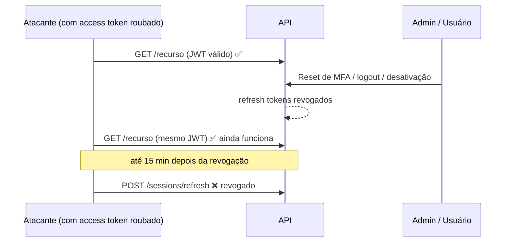

# TO-DO: revogação imediata do access token (JWT)

> **Status:** pendente · **Prioridade sugerida:** média (alta para uma API financeira)
> **Relacionado:** [authentication-flow.md › Sessão](../authentication-flow.md#7-sessão-requisições-autenticadas-refresh-logout-e-revogação)

## O problema

O access token é um JWT *stateless*. O `SecurityFilter` só confere a **assinatura** e a
**expiração** e não consulta o banco. Por isso, revogar uma sessão (logout, revogação de
sessão, reset de MFA pelo admin ou desativação do usuário) só invalida o **refresh token**.
Um access token já emitido **continua válido até expirar, por até 15 minutos**.

## Onde isso pesa

A revogação costuma acontecer **porque se desconfia de alguém**, e é aí que essa janela
mais importa:

| Cenário                         | Consequência durante a janela de até 15 min                                 |
|---------------------------------|-----------------------------------------------------------------------------|
| Reset de MFA por conta invadida | O atacante que já está logado continua usando a API                         |
| "Sair de outro dispositivo"     | O dispositivo revogado (ex.: computador público) continua com acesso       |
| Usuário desativado              | Continua usando a API até o JWT expirar (o refresh já é recusado)          |
| Admin rebaixado para `USER`     | Continua com `ROLE_ADMIN`, porque o papel está gravado no JWT              |

**O que já está coberto:** o refresh recusa sessões revogadas e usuários inativos ou não
verificados. Por isso a janela **não passa de 15 minutos**: nenhum acesso é renovado depois
da revogação.

## Opções de solução

| Opção | Como funciona | Custo por requisição | Prós | Contras |
|-------|---------------|----------------------|------|---------|
| **A. Reduzir o TTL** | Access token de 5 min em vez de 15 | Nenhum | Trivial (`JWT_EXPIRATION_TIME` e `maxAge` do cookie) | Só diminui a janela; mais chamadas de refresh |
| **B. Denylist de `jti`** | Cada JWT ganha um `jti`. Ao revogar, o `jti` vai para o Redis com TTL igual ao tempo restante do token. O filtro recusa `jti` presentes | 1 `GET` no Redis | Revogação individual e imediata; aproveita o Redis da branch do rate limiter | Exige guardar o `jti` de cada sessão ativa para conseguir revogar "todas" |
| **C. `tokenVersion` no usuário** | Campo `token_version` em `tb_users`, copiado para o JWT. Logout geral, reset de MFA, desativação e troca de papel incrementam o campo. O filtro compara o valor do token com o atual | 1 leitura (com cache no Redis, ~0) | Revoga **todas** as sessões do usuário com um `UPDATE`; cobre a troca de papel | Não revoga uma sessão específica (para isso, combine com B) |

### Recomendação

**C + A**, com B só se for preciso revogar sessões individuais na hora:

1. Adicionar `token_version` (int, default 0) ao usuário e a claim `tv` no JWT.
2. No `SecurityFilter`, comparar `tv` com a versão atual do usuário, com cache no Redis
   invalidado sempre que a versão mudar.
3. Incrementar `token_version` em:
   - `AdminResetMfaService`;
   - desativação de usuário;
   - troca de papel;
   - um futuro "sair de todos os dispositivos";
   - troca de senha (opcional; hoje o reset de senha não derruba sessões).
4. Reduzir o TTL para 5 minutos.

## Checklist de implementação

- [ ] Migração: `token_version` em `tb_users` (`@ColumnDefault("0")`, como já é feito com `version`)
- [ ] `GenerateAccessTokenUseCase`: incluir a claim `tv`
- [ ] `SecurityFilter`: validar `tv` (com cache)
- [ ] Incrementar a versão nos pontos listados acima
- [ ] Testes: o token antigo é recusado logo após o reset de MFA, a desativação e a troca de papel
- [ ] Atualizar [authentication-flow.md](../authentication-flow.md) (seções 7, 9 e 13)
